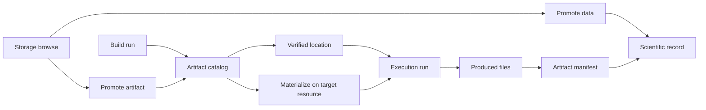

# Artifacts, storage, and builds

AkôFlow separates **scientific data** from **executable artifacts**. Files produced by a workflow can be promoted to the scientific record. Executable artifacts are immutable, versioned definitions whose bytes may have verified locations or be materialized on a target resource.

The Desktop is the easiest way to perform these operations. Every view described below uses the same HTTP API, so the API examples are suitable for scripts and integrations.

## How artifacts and storage relate



The diagram highlights two distinct paths. A build run produces an artifact whose bytes are either already at a verified location or are materialized on the target resource before execution. A storage browse can also promote an existing file directly into the artifact catalog or the scientific record. Produced files from an execution become evidence through the artifact manifest; that manifest is what makes a run scientifically citable.

## Import a public Docker Hub image

In Desktop, expand **Import from Docker Hub** in an activity's executable selector, or open **Artifacts → Build artifact**. Search for an image, choose a tag and a Linux architecture, review the artifact ID and version, and click **Import and build SIF**. The daemon resolves the selected platform to an immutable digest before registering the artifact and creating its SIF build specification. The Desktop then starts the build and follows its status. A completed, verified artifact is selected automatically when importing from a workflow activity.

The daemon must have its Apptainer builder configured. Failed or cancelled builds remain visible through the artifact's build logs; retrying from the import panel starts another run for the same registered build. Registering an image does not make it executable until its SIF bytes are published at a verified location.

Metadata endpoints use the usual AkôFlow API authentication:

- `GET /docker-hub/search/?q=python&page=1` searches public repositories.
- `GET /docker-hub/tags/?repository=library/python&q=3.12&page=1` lists tags and Linux image platforms.

Both return `{ "results": [...], "hasMore": false }`, with 20 upstream records per page. Tags without usable Linux images are omitted, so a page may have fewer than 20 results while `hasMore` is true. Successful metadata responses are cached for one minute. Docker Hub throttling returns HTTP 429 and preserves its `Retry-After` header. Repository search uses Docker Hub's public search endpoint, which is not part of its versioned Hub API reference; tags use the documented namespace API.

Register the selection with the existing Docker artifact endpoint:

```json
{
  "artifactId": "library-python",
  "version": "3.12",
  "architecture": "amd64",
  "dockerHub": { "repository": "library/python", "tag": "3.12" }
}
```

Send this body to `POST /artifacts/docker/`, then start the returned build with `POST /artifact-builds/{build.id}/runs/`. An unavailable repository, invalid tag, unsupported platform, or ambiguous platform variant is rejected before catalog registration. The original `image` request field remains available for manually specified registry references.

## Browse storage

In Desktop, open **Infrastructure**, select an environment, then open **Storage**. Choose a storage card and one of its declared roots. Entries are loaded lazily; opening this view does not scan an entire filesystem.

The actions offered for an entry depend on the storage capabilities reported by discovery. The current interface can inspect an entry, download a file, archive a directory for download, calculate a checksum, copy to another storage, promote a file, delete an entry, and start or inspect an index run. A storage may be read-only or visible only from a login node.

List the storage resources for an environment and browse a directory:

```bash
curl --fail-with-body -H "Authorization: Bearer $AKOFLOW_API_TOKEN" \
  "$AKOFLOW_API_URL/environments/$ENVIRONMENT_ID/storages/"

curl --fail-with-body -G -H "Authorization: Bearer $AKOFLOW_API_TOKEN" \
  --data-urlencode "path=/shared/project" \
  --data-urlencode "limit=100" \
  "$AKOFLOW_API_URL/storages/$STORAGE_ID/entries/"
```

Use the returned `nextCursor` as `cursor` to continue when the response is paginated. Paths are interpreted within a root allowed by the storage adapter; do not assume host filesystem semantics.

Calculate a digest or queue a copy:

```bash
curl --fail-with-body -X POST -H "Authorization: Bearer $AKOFLOW_API_TOKEN" \
  -H "Content-Type: application/json" \
  -d '{"path":"/shared/project/result.csv"}' \
  "$AKOFLOW_API_URL/storages/$STORAGE_ID/checksum/"

curl --fail-with-body -X POST -H "Authorization: Bearer $AKOFLOW_API_TOKEN" \
  -H "Content-Type: application/json" \
  -d '{"path":"/shared/project/result.csv","destinationStorageId":"storage-archive"}' \
  "$AKOFLOW_API_URL/storages/$STORAGE_ID/copies/"
```

Copy and archive operations return `202 Accepted`. Download creation returns a run that can be polled at `/storage-downloads/{downloadId}/`; fetch completed content from `/storage-downloads/{downloadId}/content/`.

## Promote existing files

Use the entry menu in **Storage** to promote an existing file. **Promote data** associates it with workflow, run, and activity context. **Promote artifact** registers executable content in the artifact catalog.

The minimal API calls are:

```bash
curl --fail-with-body -X POST -H "Authorization: Bearer $AKOFLOW_API_TOKEN" \
  -H "Content-Type: application/json" \
  -d '{
    "path":"/shared/project/result.csv",
    "workflowVersionId":"workflow-version-1",
    "runId":"run-1",
    "activityId":"analyse"
  }' \
  "$AKOFLOW_API_URL/storages/$STORAGE_ID/promote-data/"

curl --fail-with-body -X POST -H "Authorization: Bearer $AKOFLOW_API_TOKEN" \
  -H "Content-Type: application/json" \
  -d '{
    "path":"/shared/bin/model.sif",
    "name":"model",
    "version":"1.0.0",
    "scope":"project",
    "scopeId":"project-1"
  }' \
  "$AKOFLOW_API_URL/storages/$STORAGE_ID/promote-artifact/"
```

If `id` is omitted, the server generates one. Supply meaningful provenance identifiers when promoting scientific data; an anonymous promotion is valid at the transport layer but loses useful context.

## Build an executable from a Docker image

Open **Artifacts** and choose **Build artifact**. Enter an artifact ID, semantic version, registry image reference, and architecture. Desktop registers an immutable catalog version, creates a Docker-image-to-SIF build specification, and immediately starts its build run.

The equivalent two-call API flow is:

```bash
REGISTERED=$(curl -sS -X POST \
  -H "Authorization: Bearer $AKOFLOW_API_TOKEN" \
  -H "Content-Type: application/json" \
  -d '{
    "artifactId":"busybox",
    "version":"1.36",
    "image":"docker.io/library/busybox:1.36",
    "architecture":"amd64"
  }' \
  "$AKOFLOW_API_URL/artifacts/docker/")

# Read .build.id from REGISTERED, then start it:
curl --fail-with-body -X POST -H "Authorization: Bearer $AKOFLOW_API_TOKEN" \
  "$AKOFLOW_API_URL/artifact-builds/$BUILD_ID/runs/"
```

The Docker registry pull and SIF conversion run in the build service, not in the browser. Poll `/build-runs/{runId}/`. When complete, `/build-runs/{runId}/output/` streams the SIF file.

For custom recipes, first upload a build context as multipart form data:

```bash
curl --fail-with-body -X POST -H "Authorization: Bearer $AKOFLOW_API_TOKEN" \
  -F "context=@context.tar.gz" \
  "$AKOFLOW_API_URL/build-contexts/"
```

Then create an immutable build specification at `/artifact-builds/`. It requires `id`, `artifactVersionId`, `contextDigest`, `recipeDigest`, and `cacheKey`; target and recipe fields describe the desired output. A repeated cache key returns the existing build rather than creating a duplicate. The JSON form of `/build-contexts/` only records metadata for bytes already present in the artifact store and requires `digest`, `storageUri`, and a positive `sizeBytes`.

## Locations and materializations

Use **Artifacts** to see executable versions, **Artifact locations** to see verified byte locations, and **Materializations** to see preparation on target resources.

A materialization identifies a variant and digest, target resource and destination path, plus its lifecycle status: `planned`, `reconciling`, `transferring`, `verifying`, `committed`, or `failed`. A materialization is considered committed only when `verifiedDigest` equals the requested `digest`.

```bash
curl --fail-with-body -H "Authorization: Bearer $AKOFLOW_API_TOKEN" \
  "$AKOFLOW_API_URL/artifact-locations/"

curl --fail-with-body -G -H "Authorization: Bearer $AKOFLOW_API_TOKEN" \
  --data-urlencode "runId=$RUN_ID" \
  "$AKOFLOW_API_URL/artifact-materializations/"
```

Execution detail also shows prepared artifacts and transfer activity. Use it to relate catalog identity to the bytes actually made available for an activity.

:::warning Credentials and paths
Do not put registry credentials, SSH secrets, or cloud secrets in artifact payloads. Use configured credential references. Browser-local file paths are not server build contexts; upload the bytes or register artifact-store metadata.
:::

## Follow artifacts in Desktop

The **Data** entry point separates executable artifacts from observed scientific data. Open **Artifacts** to inspect build identity and readiness.


An artifact detail shows the registered source and build specification. Registration creates identity and configuration; it does not by itself prove that a build completed.


Locations and materializations answer different questions: locations show where copies are known, while materializations track delivery to an execution target.


