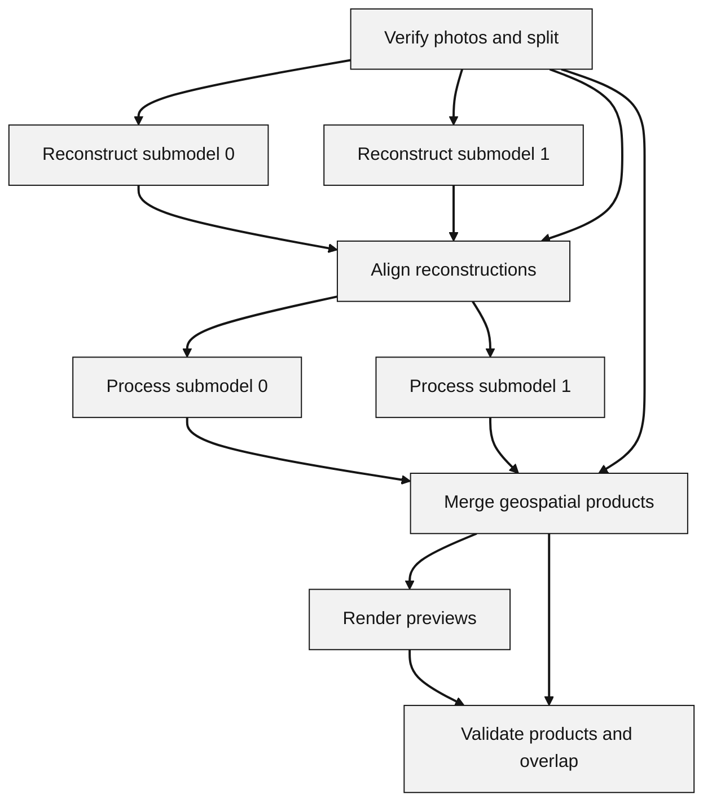

import WorkflowHubLinks from "@site/src/components/WorkflowHubLinks";

# OpenDroneMap — Caliterra split/merge

Turn **77 GPS-tagged aerial photographs** of Caliterra, Dripping Springs, Texas into a georeferenced orthomosaic, a surface-elevation raster and a colored point cloud. AkôFlow schedules two reconstruction activities and two dense-processing activities in parallel, with explicit artifact transfers between the native OpenDroneMap stages.

<WorkflowHubLinks examplePath="scientific-workflows/opendronemap" />

## Workflow



The split uses longitude and adds overlapping photographs within 40 metres through OpenSfM. Reconstruction and alignment use native OpenSfM methods; dense processing and final merging use OpenDroneMap's own implementation. The validator rejects missing reconstructions, duplicated full datasets, and groups sharing fewer than five photographs.

## Measured results

All **nine activities completed** in the recorded Docker-backed daemon execution. The final cloud contains **4,510,286 points**, equal to the sum of the two submodel clouds. Reconstruction workers overlapped for **32.14 seconds** and product-processing workers for **689.83 seconds**. The recorded run recovered after an external daemon restart; its duration is not an uninterrupted performance benchmark.

| Product                 | Validated dimensions          | Reference system           |
| ----------------------- | ----------------------------- | -------------------------- |
| Orthomosaic GeoTIFF     | 885 × 1008 pixels, four bands | EPSG:32614                 |
| Surface GeoTIFF         | 442 × 503 pixels, one band    | EPSG:32614                 |
| Colored LAZ point cloud | 4,510,286 points              | Georeferenced native merge |


This animation combines input-photo thumbnails and a progressive reveal of the final raster. It illustrates the result and does not depict intermediate reconstruction states or execution timing.


The turntable renders decimated measured LAZ points with their original RGB values. The downloadable cloud retains every point.

## Run locally

Install Python 3, Go 1.23+ and Docker with **linux/amd64** support. Start with four available CPU cores, 16 GiB RAM and 20 GiB free disk; these are suggested capacities, not measured minima. Apple Silicon requires amd64 emulation. Preparation downloads the pinned runtime and original photographs; standalone scientific execution disables container networking.

From a checkout of the versioned source bundle:

```bash
cd scientific-workflows/opendronemap
./prepare.sh
./run.sh
./validate.sh
```

The runtime is **OpenDroneMap 3.5.6**, pinned by image digest. The exact executed image is distributed as an approximately **824 MiB Docker archive**, available with the [source, results and SHA-256 checksums](https://github.com/UFFeScience/akoflow-examples/releases/tag/opendronemap-caliterra-v1). Download the archive and load it before executing the imported Hub workflow:

```bash
docker load -i opendronemap-executed-image.tar.gz
```

The archive restores `akoflow-local/opendronemap:local-ce38c348fa95a1f0`, including the original photographs. This local image tag requires the archive or a source build; it is not a publicly pullable registry image.

## Provenance and scientific limits

Dennis Baldwin / Unmanned Airlines supplied the photographs under **CC0-1.0**. Dataset revision `bec3dc7296e90aacb3930eb9df8061849fbfe0d0` is frozen with a byte count and SHA-256 for each image. Validation reopens the geospatial products, checks coordinate systems and nonempty finite data, verifies the merged point count, records product hashes and checks observed worker overlap.

The profile uses low feature quality, lowest dense-cloud quality, a 50,000-vertex mesh, 20 cm/pixel orthophoto resolution and 40 cm/pixel surface resolution. Requested pixel spacing does not establish positional accuracy. GPS metadata provides georeferencing; no ground-control measurements are available for an independent accuracy assessment. CI validates the pinned image and workflow contract; it does not claim a fresh scientific reconstruction.
