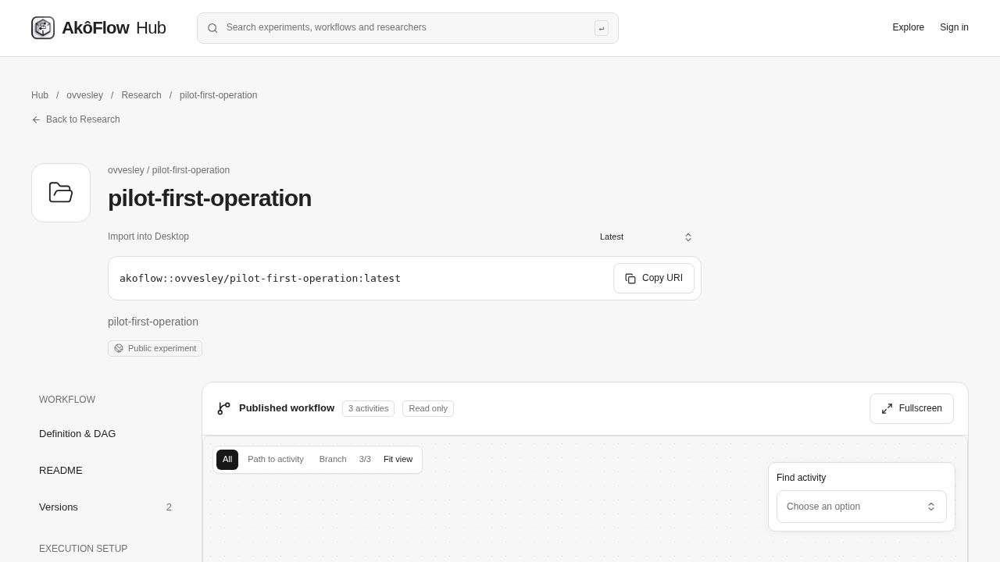
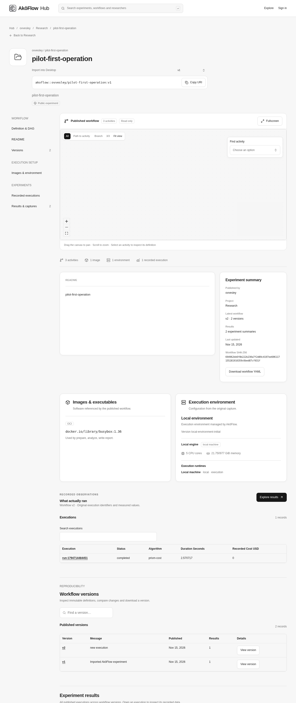
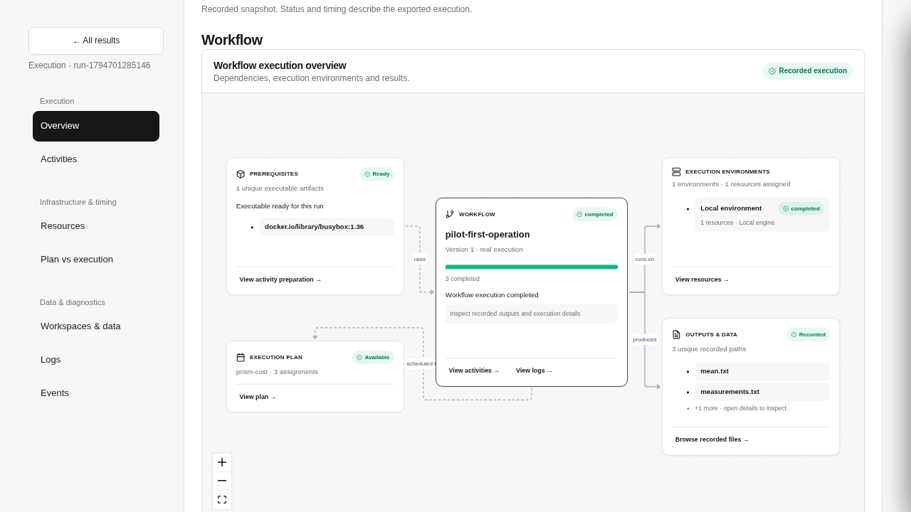

# AkôFlow v1.0.16 — Publish and reuse workflows with AkôFlow Hub

This release connects AkôFlow Desktop to https://hub.akoflow.com and adds a reviewed publishing and workflow-import flow.

## Publish execution results from Desktop

- Connect a project through browser sign-in and authorize the destination in Hub.
- Create or select a publication, edit its title and slug, and review visibility before publishing.
- Select which captured sections to include: file references, metrics, events and available process-log observations.
- Publish the workflow definition and recorded execution capture; datasets and binaries are not uploaded.
- Keep Hub credentials in the daemon, outside browser storage.

## Import a workflow definition

- Import named references such as `akoflow::ovvesley/story-signal-study:latest` or pin a specific version.
- Review the resolved YAML before creating the workflow. Import brings in the workflow definition, not remote execution data or credentials.
- Choose a local name for a separate copy. Existing workflow names now produce an actionable conflict with a link to the existing workflow instead of a raw database constraint error.

## Explore published experiments

The independently deployed Hub presents a large workflow DAG, immutable version history, code and diffs, and captured execution results. Execution identifiers link directly to their details; categorized fixed navigation follows the visible execution section.

## Execution and workspace improvements

- Validate local resource allocation against detected host capacity.
- Improve environment allocation forms and access to recorded workspace files.
- Register browsable activity workspace storage and keep unsupported runtimes out of local browsing.
- Enable the interactive console in the packaged Desktop runtime.

## Screenshots

These captures show the local integration environment. The Hub is deployed separately from the Desktop and daemon release.
