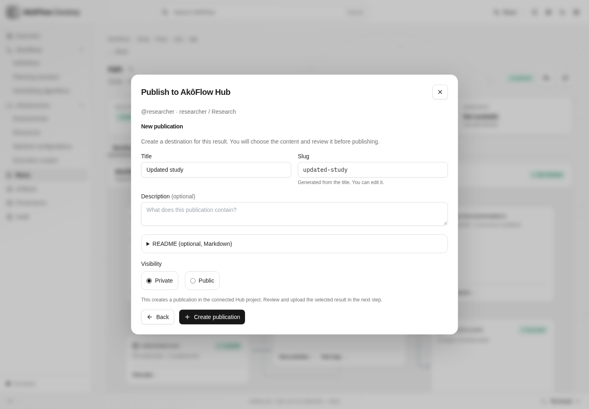
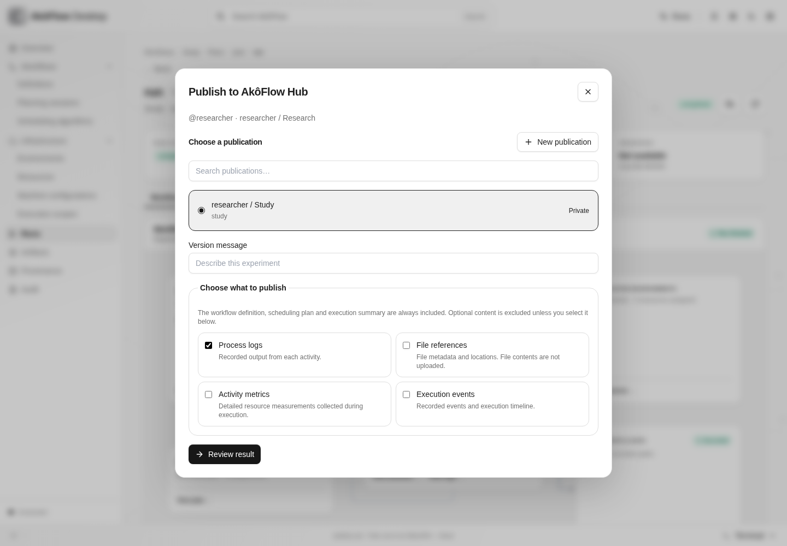
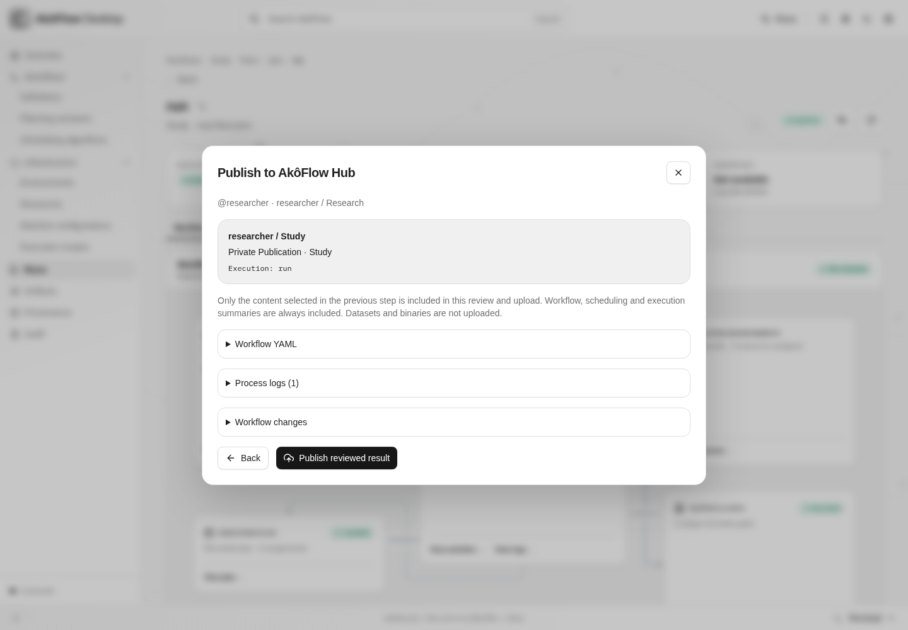
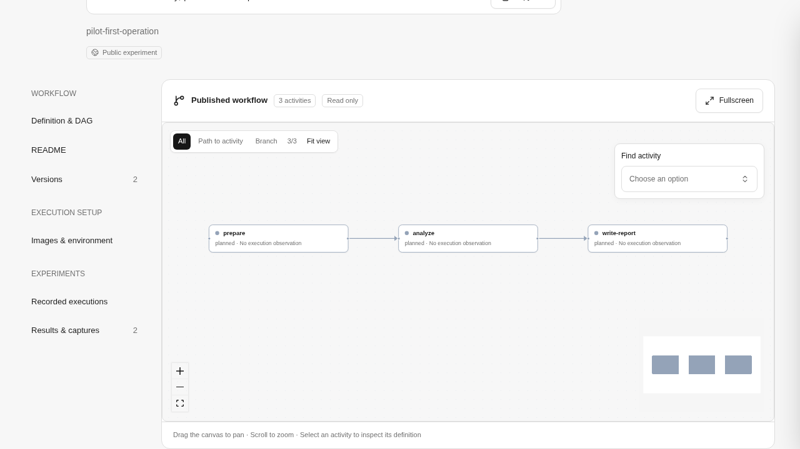
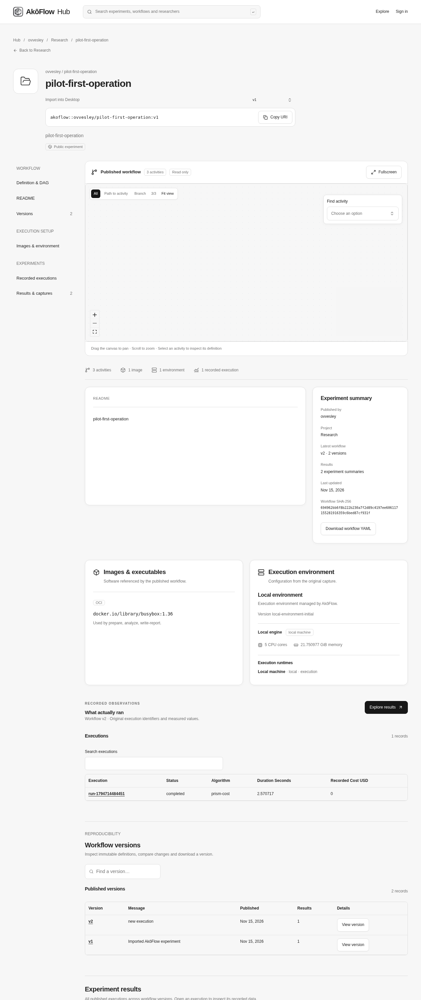
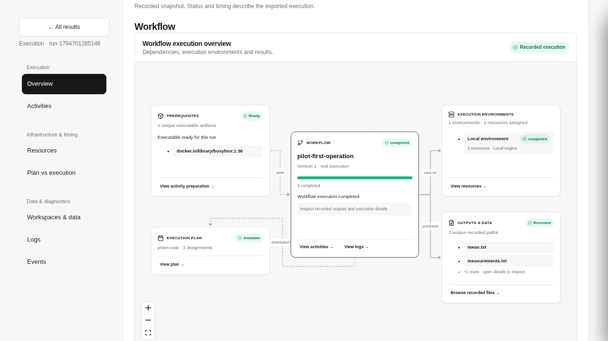

# AkôFlow v1.0.17 — Publish and reuse workflows with AkôFlow Hub

This release connects AkôFlow Desktop to https://hub.akoflow.com and adds a reviewed publishing and workflow-import flow.

## Publish execution results from Desktop

- Connect a project through browser sign-in and authorize the destination in Hub.
- Create or select a publication, edit its title and slug, and review visibility before publishing.
- Select which captured sections to include: file references, metrics, events and available process-log observations.
- Publish the workflow definition and recorded execution capture; datasets and binaries are not uploaded.
- Keep Hub credentials in the daemon, outside browser storage.

## Import a workflow definition

- Import named references such as `akoflow::ovvesley/story-signal-study:latest` or pin a specific version.
- Review the resolved YAML before creating the workflow. Import brings in the workflow definition, not remote execution data or credentials.
- Choose a local name for a separate copy. Existing workflow names now produce an actionable conflict with a link to the existing workflow instead of a raw database constraint error.

## Explore published experiments

The independently deployed Hub presents a large workflow DAG, immutable version history, code and diffs, and captured execution results. Execution identifiers link directly to their details; categorized fixed navigation follows the visible execution section.

## Execution and workspace improvements

- Validate local resource allocation against detected host capacity.
- Improve environment allocation forms and access to recorded workspace files.
- Register browsable activity workspace storage and keep unsupported runtimes out of local browsing.
- Enable the interactive console in the packaged Desktop runtime.

## How it works: connect Desktop to Hub

1. Open the Hub connection controls in Desktop and start the connection.
2. In the browser, sign in to Hub and verify your email if requested.
3. Confirm that the displayed device code matches Desktop, choose the destination project, and authorize access.
4. Return to Desktop. The daemon stores the connection credentials and uses the selected Hub project for publishing.

The packaged runtime points to `https://hub.akoflow.com`. A connection does not publish an execution automatically: publication still requires a review and confirmation.

## Walkthrough: publish a recorded execution

Open an execution in Desktop and choose **Publish to Hub**. Select an existing publication or choose **New publication**.

### 1. Describe the publication

Enter a title, review the generated slug, and choose its visibility. You can edit the slug independently; **Reset** generates it again from the current title. Add a description and README to explain the experiment and how to interpret it.

### 2. Choose the information to share

Select the available captured sections before requesting the preview. The workflow definition and execution identity provide the baseline; optional sections let you control the observations included in the capture. File references identify source paths and locations; they do not upload the referenced datasets or binaries.

### 3. Review before publishing

Choose **Review result** to inspect the prepared capture and destination. Check the YAML and selected sections, then choose **Publish reviewed result**. Public publishing requires its explicit visibility acknowledgement. The result links back to the publication after confirmation.

The three Desktop screenshots above use the actual interface with controlled demonstration API responses. They illustrate the review flow; they are not evidence of delivery to the public Hub.

## Walkthrough: inspect a publication

### Start with the workflow graph

The DAG is the main entry point. Pan and zoom to inspect the workflow, select an activity for its definition, or use the activity search. The README explains the experiment alongside immutable workflow versions.

### Open an execution from Results

Use **Results** to locate recorded executions. Filter by environment, algorithm, mode or status, or search for an execution identifier. Click the execution ID or **Open execution** to inspect the corresponding capture. Recorded duration and cost describe the exported observations.

### Navigate captured details

The fixed execution menu groups overview and activities, resources and plan-versus-execution timing, and workspaces, logs and events. Sections remain stacked; the highlighted menu item follows the visible section as you scroll. Each execution also has a directly addressable URL.

Unavailable observations remain unavailable: publishing does not reconstruct missing logs, retrieve dataset contents, or rerun the workflow. The Hub is deployed separately from the Desktop and daemon release. Hub screenshots show the local integration environment.

## Walkthrough: reuse a definition in Desktop

1. On a Hub publication, select **Latest** or a specific version and choose **Copy URI**.
2. In Desktop workflow creation, choose **Import from Hub** and paste the URI.
3. Choose **Load definition** and review the resolved YAML.
4. Optionally enter a local workflow name to create a separate copy, then confirm the import.

For example, `akoflow::ovvesley/story-signal-study:latest` follows the latest published definition. Use the version selector to obtain a fixed reference when reproducibility matters. Importing a definition does not import execution history, provision machines, or run activities. If the local name already exists, Desktop offers the existing workflow and lets you choose another name.

## Packaging correction

Regenerated the MCP tool catalog from the current daemon routes and request types. This resolves the catalog freshness check that blocked the previous release candidate. Version 1.0.17 supersedes the unpublished 1.0.16 draft; the earlier tags are preserved.
