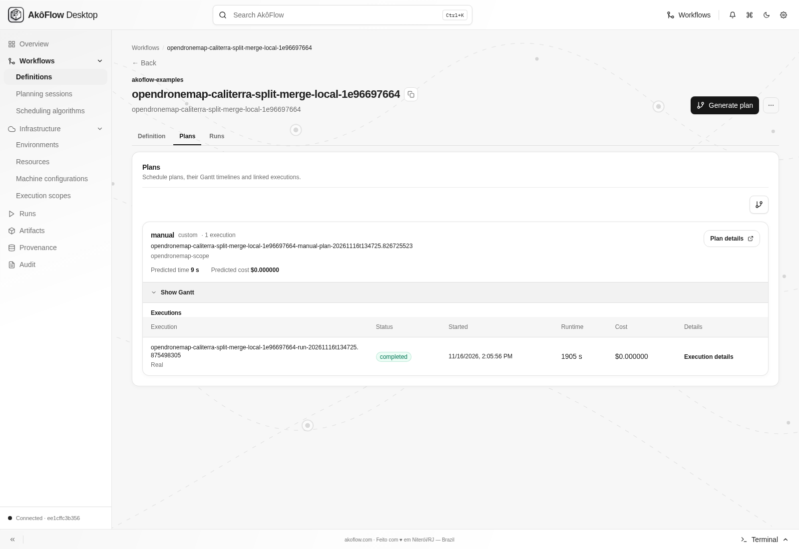
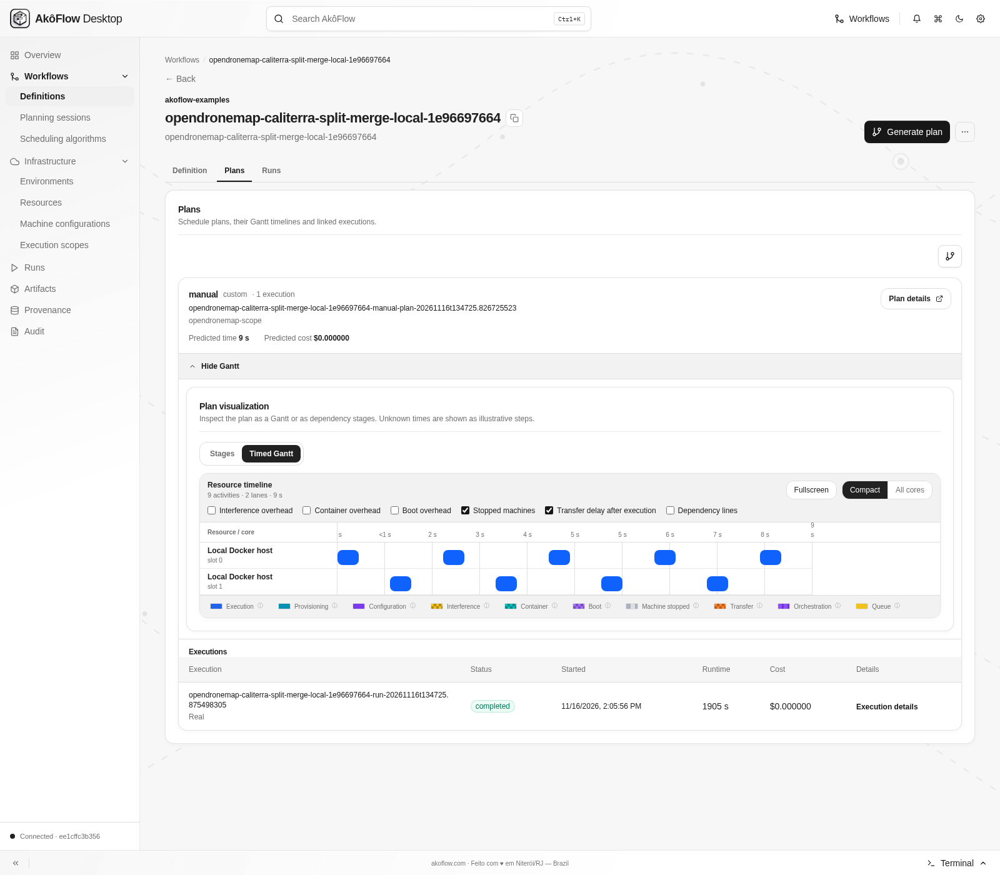
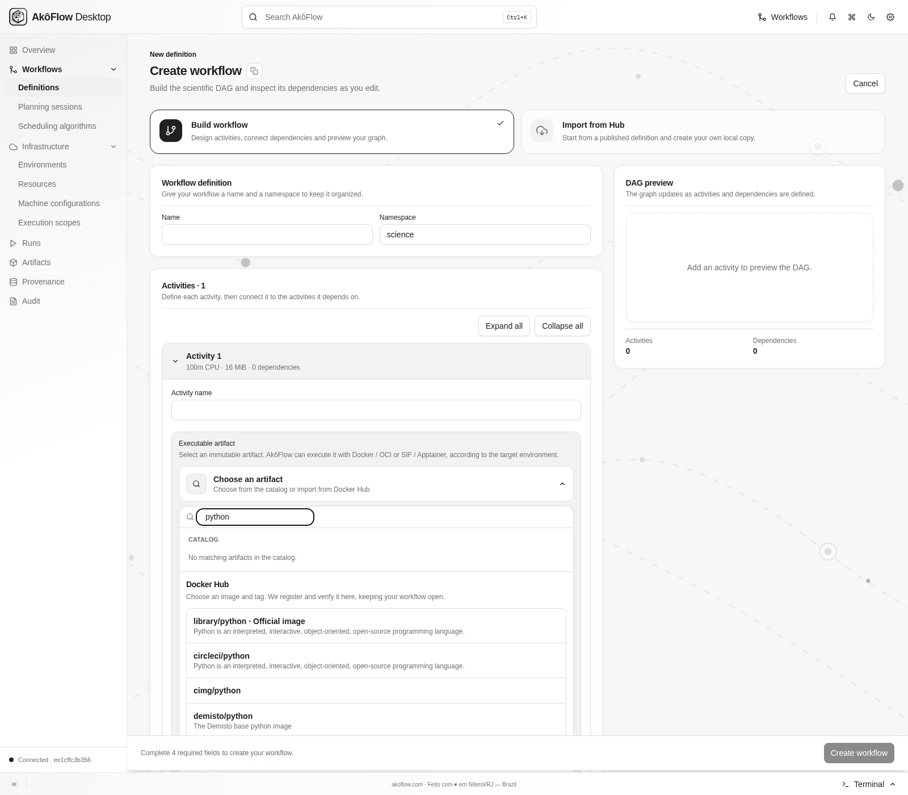

# AkôFlow v1.0.22 — Plans, workflow authoring and scientific examples

## Plans and executions together

The workflow Plans view now lists each plan with its own linked executions, predicted duration and cost. Open plan details or execution details independently. The execution-comparison chart has been removed from this view.

Expand **Show Gantt** to inspect the same **Plan visualization** available inside plan details, including dependency stages and timed or illustrative Gantt views. Expansion loads the full plan: catalog summaries alone do not contain activity assignments. Plans without executions remain visible.

## Workflow authoring and catalog

- Search local artifacts and Docker Hub in one picker, select an image tag and architecture, and register an artifact without losing the workflow draft.
- Import and review workflow YAML from Hub, preserving existing activity command fields when unchanged.
- Duplicate workflows into the editor and archive or restore workflow definitions. Archived workflows remain available for historical inspection; restore them before creating new planning sessions.
- Use consistent graph controls, activity resource inputs and code editing throughout workflow creation.
- Validate publication titles, slugs, descriptions and README sizes in Desktop and the daemon, and surface actionable Hub validation errors.

The screenshots show the actual local interface reading persisted records. They did not start a new execution or publish new results. The displayed execution measurements are historical observations, not performance guarantees. [Capture provenance](https://github.com/UFFeScience/akoflow/blob/v1.0.22/docs/static/img/releases/v1.0.22/provenance.json).

## Scientific examples and Hub

The examples repository adds the OpenDroneMap Caliterra split/merge workflow with recorded execution, output provenance, public Hub references and publication animations, and integrates the GAWA stellar-cluster workflow with the shared runners and catalog. These examples retain their own input, runtime and scientific-validation requirements.

The independently deployed Hub main branch includes anonymous publication links, optional email verification for ordinary workspace access, a global mail BCC option and branded HTML transactional emails. Hub deployments are separate from installing Desktop.

## Installation

The synchronized `v1.0.22` tags freeze the daemon/documentation and Desktop sources. The existing GitHub Actions release pipeline builds runtime archives for Linux amd64/arm64 and Desktop packages for Linux, Windows and macOS; packages and updater manifests are attached by that pipeline.

Use Docker Desktop on macOS/Windows or Docker Engine with the Compose v2 plugin on Linux. On macOS, copy the app from its DMG into Applications before launching. Secure automatic macOS installation updates require a configured Developer ID signing identity; use manual installation for unsigned builds.

## Validation

- Daemon: full `go test ./...` passed with CGO/SQLite and rsync available.
- Desktop: 143 unit tests, 52 packaging contracts and patched dependency-security checks passed.
- Browser: 113 development checks passed with one Electron-only skip; all 46 selected production checks passed. Coverage includes complete-plan loading from summary records, Gantt/stage rendering, owner-specific detail links and drawer portal interactions.
- Screenshots: three actual-interface captures with no browser page errors.

Native installation and automatic-update flows have not been manually revalidated on macOS or Windows for this release. GitHub Actions packaging status remains separate from these source and browser checks.
