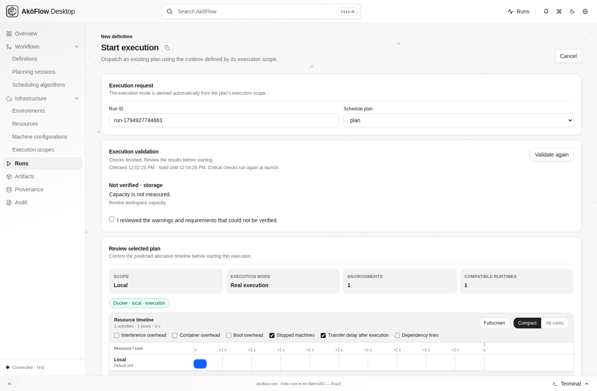

# AkôFlow v1.0.23 — Execution validation and recovery

## Validate before execution

Desktop now shows prerequisite checks before starting an execution. Review configuration, connection access, declared input files, artifact compatibility and measured storage budgets. Blocking checks prevent launch; warnings and unverified requirements need explicit acknowledgment. Changing the run or plan invalidates review.

Reports are persisted without execution payloads or credential values, expire after two minutes and bind to the submitted configuration. The daemon repeats checks before queueing work. API and MCP use the same boundary, including direct execution requests.

This screenshot is the actual Desktop renderer with controlled API fixtures used by browser regression tests. It illustrates review behavior and is not evidence of a real workload or measured infrastructure capacity.

[Validation guide](https://github.com/UFFeScience/akoflow/blob/v1.0.23/docs/docs/guides/workflows/preflight.md).

## Reliable failure handling

- Runtime observation outages preserve live activity ownership and prevent duplicate starts. After three consecutive failed observations, cancellation and reconciliation remain tracked instead of assuming the workload stopped.
- Failure and cancellation database-write errors are reported alongside the original execution error. Failed writes no longer silently replace authoritative task state.
- Interrupted portable artifact publication checks for a committed output before declaring rollback. Confirmed rollback is recorded as failed; unknown outcomes retain reconciliation.
- Portable image architecture and runtime compatibility are checked before launch. Local source reproduction, Kubernetes OCI requirements and Slurm SIF requirements have distinct guidance.
- Docker Hub imports stop indefinite catalog polling after completed builds. Status checks can be retried without starting another build.
- Operational errors include stable codes, stages, affected entities, recovery guidance and correlation IDs while preserving legacy error messages. Recognizable credentials and private keys are redacted from preparation diagnostics and transfer failures.

## Compatibility and limits

External input checks use optional activity metadata `requiredInputs` with storage/path assertions; arbitrary command text is not interpreted. Predecessor outputs are checked when produced. Missing input declarations or measured capacity are reported as unverified.

Image validation inspects cached images or registry manifests without downloading them. Portable recipes are validated and builder availability checked; actual build success and destination-specific access remain preparation/runtime checks. Simulation does not probe real infrastructure. Validation does not provision machines or reserve resources.

Real API/MCP clients must explicitly acknowledge advisory/unverified requirements using `acknowledgeWarnings`; an optional `preflightId` must match a valid report. Existing instance schema is preserved: reports use the event store.

## Validation

- Daemon source suites pass with CGO/SQLite and rsync available, including failure injection, uncertainty, publication reconciliation, preflight receipts and mutable input rechecks.
- Desktop: 148 unit tests and production web build pass.
- Chromium: prerequisite review, blockers, acknowledgment and context invalidation are covered by two focused browser regressions.
- MCP catalog and generated API documentation include the new validation endpoints.

Native macOS/Windows installation, signing, updates and live remote registry/HPC/cloud execution have not been revalidated in this change. Source/browser validation is separate from release packaging.

## Release preparation

Tracking issue: #265. Scope: #208 and #266–#271. The coordinated source changes are available in the daemon and Desktop `AKO-265` branches and their release PRs.

This is a draft release. Desktop package version is prepared as 1.0.23. Platform installers, runtime archives and updater manifests must be built from synchronized frozen tags by the existing release workflow before stable publication.
